# Browser Bridge

Control your existing browsers from any local MCP agent, with visible activity and shared tab ownership.

Compared with the [ChatGPT extension](https://learn.chatgpt.com/docs/chrome-extension), Browser Bridge exposes raw page/browser CDP and extension APIs without adding website allowlists or per-site approval gates. Use your preferred agent and customize routing, cursor, favicon and pacing. Agent policies and browser/OS protections still apply.

[Checks](https://github.com/faqihxdev/browser-bridge/actions/workflows/checks.yml)



## Architecture

A shared Node.js 24 manager routes MCP agents to persistent Playwright/CDP controllers, one per browser. Authenticated local pipes connect stdio adapters and Native Messaging hosts. The MV3 extension supplies browser APIs and a compact status/stop popup. Its live connection identity is verified inside the selected browser before API routing. Windows UI Automation handles native controls.


## Engineering highlights

| Capability       | Implementation                                                                                                                                                                                                                              |
| ---------------- | ------------------------------------------------------------------------------------------------------------------------------------------------------------------------------------------------------------------------------------------- |
| Browser routing  | Local discovery, names and aliases, independent selection per agent and a persistent controller per browser. Browser-qualified tab IDs retain their original destination.                                                                   |
| Fast actions     | Ordered batches reduce agent round trips. Targeted snapshots and bounded request history keep responses small. Background actions have no intentional pacing delay.                                                                         |
| Tab ownership    | One agent per tab. Release and disconnect restore indicators. Human stop invalidates queued work and active batches.                                                                                                                        |
| Visible activity | Persistent cursor and favicon overlay. Watched tabs move it along a slight arc in 400 to 700 ms, scaled by distance, with 150 ms action pauses; switching away cancels pacing. At rest it drifts a few pixels. Release restores indicators. |
| Broad access     | Page actions, JavaScript, raw page/browser CDP, cookies, network details, screenshots, PDFs, uploads and extension browser APIs.                                                                                                            |
| Native Windows   | UI inspection, invocation, values, menus, keyboard/mouse input and window screenshots through a persistent helper.                                                                                                                          |
| Verification     | Real-browser tests cover input, ownership, cancellation, navigation, favicon restoration, independent MCP clients and two simultaneous extension/native-host connections.                                                                   |

## Setup

Use Node.js 24 and pnpm 11.1.1.

```powershell
pnpm install --frozen-lockfile
pnpm build
pnpm setup:local --codex
```

In each browser, enable Developer mode at `chrome://extensions` and load unpacked `dist/extension`. Chromium browsers redirect these addresses to their own internal pages.

Load unpacked registers the extension persistently in that profile. The `--load-extension` flag loads it only for launches that supply the flag.

Choose a connection:

- **Existing profile:** enable remote debugging at `chrome://inspect/#remote-debugging`. Approve each new connection when prompted.
- **Unattended:** launch with a custom `--user-data-dir`, fixed nonzero `--remote-debugging-port` and `--remote-debugging-address=127.0.0.1`. Save these flags in every launch shortcut. Configure its endpoint in `%LOCALAPPDATA%\BrowserBridge\config.json`:

  ```json
  {
    "browser": "edge-agent",
    "browsers": [{ "id": "edge-agent", "browser": "edge", "endpoint": "http://127.0.0.1:19224" }]
  }
  ```

  This avoids the inspect-page approval prompt. Start with a fresh profile and sign in manually; copying encrypted profile data is unreliable. Port `0` enables the automation flag and can affect sign-in. Fixed-port Google sign-in was verified in Edge; website behavior can change.

`--codex` adds the MCP server to your user Codex configuration. Restart the agent connection to load it. For other MCP clients, copy the generated `mcpServers` entry from `%LOCALAPPDATA%\BrowserBridge\mcp.json`.

Ask your agent to "control Brave" or "control Edge". Each agent keeps its own selection; existing tab IDs retain their browser. Duplicate names require the browser ID from discovery. Foreground focus is preserved unless requested.

The manager starts with the first agent or extension connection and exits ten minutes after the last disconnects. `pnpm browsers` lists discovered browsers. `pnpm doctor --browser Brave` checks attachment; `pnpm status` reports active control; `pnpm stop` disconnects and restores indicators.

Discovery covers Edge, Chrome, Brave, Vivaldi, Opera/GX and Chromium, including Scoop installs. Custom `browsers` entries accept `name`, `aliases` and `userDataDir`. Settings and credentials stay in `%LOCALAPPDATA%\BrowserBridge`; `BROWSER_BRIDGE_HOME` selects a separate runtime directory.

On Windows, optional `browsers[].windowsJumpList` settings accept `appId`, `cacheFile`, `executable` and common launch `arguments`. The controller watches that app's taskbar cache and restores normal/private window tasks through the Windows shell API when the browser drops its launch flags. Use the pinned shortcut's profile-specific AppUserModelID. PowerShell runs only during repairs.

## Development

```powershell
pnpm check
pnpm test
pnpm test:integration
pnpm test:extension
```

Browser tests use isolated Playwright Chromium, installed with `pnpm exec playwright-core install chromium`. Extension tests also need setup registration. CI runs types, build and browser tests on Windows and Linux.

Use Conventional Commits and `<name>/<type>-<description>` branches. Keep credentials, screenshots and browser content out of Git.

## Scope

The backend supports Chromium browsers. Firefox and Safari need separate backends. Independently named profiles use separate user-data directories. Connection prompts and debugging banners depend on the connection mode and browser.

Control runs locally; requested results still reach your chosen agent. Ownership coordinates clients but does not isolate shared cookies or storage. Raw CDP and extension APIs are privileged escape hatches.

Favicons remain subject to site and browser behavior. Native OS input uses the foreground desktop. Protected browser pages and OS security boundaries still apply.
