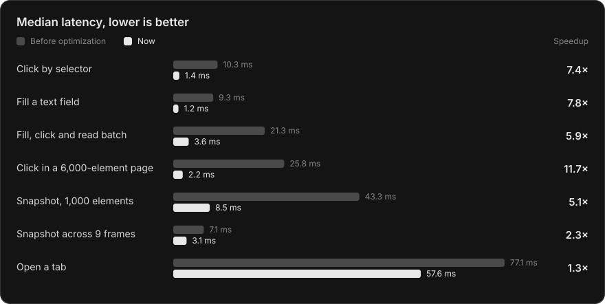

# Browser Bridge

Control your existing browsers from any local MCP agent, with visible activity and shared tab ownership.

Unlike the [ChatGPT extension](https://learn.chatgpt.com/docs/chrome-extension), Browser Bridge exposes raw page and browser CDP plus extension APIs, with no website allowlists or per-site approval gates. Agent policies and browser and OS protections still apply.

[Checks](https://github.com/faqihxdev/browser-bridge/actions/workflows/checks.yml)


## Architecture

A shared Node.js manager routes MCP agents to one persistent Playwright/CDP controller per browser. Authenticated local pipes connect stdio adapters and Native Messaging hosts. The MV3 extension supplies browser APIs and a status and stop popup once its connection identity is verified inside the selected browser. Windows UI Automation handles native controls.


## Highlights

| Capability       | Implementation                                                                                                                                                                                  |
| ---------------- | ----------------------------------------------------------------------------------------------------------------------------------------------------------------------------------------------- |
| Browser routing  | Discovery by name or alias, a separate browser selection per agent and one persistent controller per browser. Tab IDs keep their browser.                                                       |
| Fast actions     | Unobstructed clicks, hovers and text fills take one page call plus the input events. Batches and targeted snapshots cut agent round trips. Background tabs keep your foreground focus.          |
| Tab ownership    | One agent per tab. Idle tabs release after 5 minutes and the next action reclaims them. A human stop cancels queued work and active batches.                                                    |
| Visible activity | A cursor and favicon overlay mark controlled tabs. In a watched tab the cursor travels tip first along varied paths and drifts at rest; switching away drops the pacing. Release restores both. |
| Broad access     | Page actions, JavaScript, raw CDP, cookies, network details, screenshots, PDFs, uploads and extension APIs.                                                                                     |
| Native Windows   | UI inspection, invocation, values, menus, input and window screenshots through a persistent helper.                                                                                             |
| Verification     | Real-browser tests cover input, ownership, cancellation, navigation, indicators, several MCP clients and two simultaneous extension connections.                                                |

## Performance



Median controller latency in headless Chromium on Windows 11, compared with the code [before optimization](https://github.com/faqihxdev/browser-bridge/commit/6a66edd). Run `pnpm benchmark:latency` to reproduce it. Background tabs act without pacing. What remains is mostly browser time: a pointer move waits for the next frame, a screenshot for one or two frames and a new tab for its renderer process.

## Setup

Use Node.js 24 and pnpm 11.1.1.

```powershell
pnpm install --frozen-lockfile
pnpm build
pnpm setup:local --codex
```

In each browser, turn on Developer mode at `chrome://extensions` and load unpacked `dist/extension`. Other Chromium browsers redirect these addresses to their own pages. Load unpacked persists in that profile, while `--load-extension` lasts only for launches with the flag.

Then connect the browser one of two ways:

- **Existing profile:** enable remote debugging at `chrome://inspect/#remote-debugging` and approve each new connection.
- **Unattended:** launch with a custom `--user-data-dir`, a fixed nonzero `--remote-debugging-port` and `--remote-debugging-address=127.0.0.1` in every shortcut, then add the endpoint to `%LOCALAPPDATA%\BrowserBridge\config.json`:

  ```json
  {
    "browser": "edge-agent",
    "browsers": [{ "id": "edge-agent", "browser": "edge", "endpoint": "http://127.0.0.1:19224" }]
  }
  ```

  This skips the approval prompt. Start from a fresh profile and sign in manually; copied encrypted profile data is unreliable. Port `0` sets the automation flag and can break sign-in. Google sign-in works with a fixed port in Edge.

`--codex` registers the MCP server with Codex; restart the agent connection to load it. Other MCP clients can copy the `mcpServers` entry from `%LOCALAPPDATA%\BrowserBridge\mcp.json`. Then ask your agent to "control Edge" or "control Brave". Duplicate names need the browser ID from `pnpm browsers`.

### Operation

- The manager starts with the first connection and exits ten minutes after the last one closes.
- `releaseIdleMs` in `config.json` sets the idle release, 300000 ms by default. `0` keeps claims until release.
- Discovery covers Edge, Chrome, Brave, Vivaldi, Opera, Opera GX and Chromium, including Scoop installs. Custom `browsers` entries accept `name`, `aliases`, `userDataDir` and `endpoint`.
- Settings and credentials live in `%LOCALAPPDATA%\BrowserBridge`. `BROWSER_BRIDGE_HOME` selects another directory.
- `pnpm browsers` lists browsers, `pnpm doctor --browser Edge` checks attachment, `pnpm status` reports control and `pnpm stop` disconnects and restores indicators.
- On Windows, `browsers[].windowsJumpList` takes `appId`, `cacheFile`, `executable` and `arguments`. The controller restores the taskbar's normal and private window tasks when the browser drops its launch flags. Use the pinned shortcut's profile-specific AppUserModelID.

## Development

```powershell
pnpm check
pnpm test
pnpm test:integration
pnpm test:extension
pnpm benchmark:latency
```

Browser tests and the benchmark use isolated Playwright Chromium from `pnpm exec playwright-core install chromium`. Extension tests also need setup registration. CI runs types, build and browser tests on Windows and Linux. Use Conventional Commits and `<name>/<type>-<description>` branches, and keep credentials, screenshots and browser content out of Git.

## Scope

Browser Bridge supports Chromium browsers; Firefox and Safari would need separate backends. Independently named profiles need separate user-data directories, and connection prompts and debugging banners depend on the browser and connection mode.

Control runs locally, but requested results reach your chosen agent. Ownership coordinates agents without isolating shared cookies or storage, and raw CDP and extension APIs are privileged. Favicons depend on site and browser behavior, and native input uses the foreground desktop. Protected browser pages and OS security boundaries still apply.
