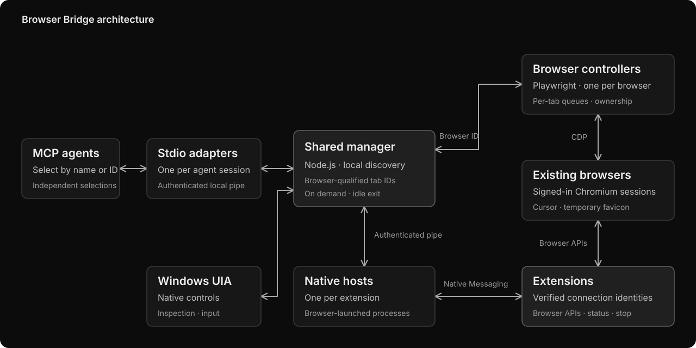

# Browser Bridge

Control your existing browsers from any local MCP agent, with visible activity and shared tab ownership.

[Checks](https://github.com/faqihxdev/browser-bridge/actions/workflows/checks.yml)

## Architecture

A shared Node.js 24 manager routes MCP agents to persistent Playwright/CDP controllers, one per browser. Authenticated local pipes connect stdio adapters and Native Messaging hosts. The MV3 extension supplies browser APIs and a compact status/stop popup. Its live connection identity is verified inside the selected browser before API routing. Windows UI Automation handles native controls.



## Engineering highlights

| Capability       | Implementation                                                                                                                                                            |
| ---------------- | ------------------------------------------------------------------------------------------------------------------------------------------------------------------------- |
| Browser routing  | Local discovery, names and aliases, independent selection per agent and a persistent controller per browser. Browser-qualified tab IDs retain their original destination. |
| Fast actions     | Ordered batches reduce agent round trips. Targeted snapshots and bounded request history keep responses small. Background actions have no intentional pacing delay.       |
| Tab ownership    | One agent per tab. Release and disconnect restore indicators. Human stop invalidates queued work and active batches.                                                      |
| Visible activity | Persistent cursor and favicon overlay. Watched tabs use 500 ms eased movement and 150 ms action pauses; switching away cancels pacing. Release restores indicators.       |
| Broad access     | Page actions, JavaScript, raw page/browser CDP, cookies, network details, screenshots, PDFs, uploads and extension browser APIs.                                          |
| Native Windows   | UI inspection, invocation, values, menus, keyboard/mouse input and window screenshots through a persistent helper.                                                        |
| Verification     | Real-browser tests cover input, ownership, cancellation, navigation, favicon restoration, independent MCP clients and two simultaneous extension/native-host connections. |

## Setup

Use Node.js 24 and pnpm 11.1.1.

```powershell
pnpm install --frozen-lockfile
pnpm build
pnpm setup:local --codex
```

In each browser, open `chrome://inspect/#remote-debugging` and enable remote debugging. In `chrome://extensions`, enable Developer mode and load the unpacked `dist/extension` folder. Chromium browsers redirect these addresses to their own internal pages. Approve the browser's connection prompt when an agent attaches.

`--codex` adds the MCP server to your user Codex configuration. Restart the agent connection to load it. For other MCP clients, copy the generated `mcpServers` entry from `%LOCALAPPDATA%\BrowserBridge\mcp.json`.

Ask your agent to "control Brave" or "control Edge". One MCP connection exposes all browsers. Each agent keeps its own selection; existing tab IDs retain their browser. Duplicate names require the browser ID from discovery.

The manager starts with the first agent or extension connection and exits ten minutes after the last disconnects. `pnpm browsers` lists discovered browsers. `pnpm doctor --browser Brave` checks attachment; `pnpm status` reports active control; `pnpm stop` disconnects and restores indicators.

Settings and credentials live in `%LOCALAPPDATA%\BrowserBridge`. In `config.json`, `browser` sets the default name or ID. Discovery covers Edge, Chrome, Brave, Vivaldi, Opera/GX and Chromium, including Windows Scoop installs. Add `browsers` entries with `id`, `name`, optional `aliases`, and `userDataDir` or `endpoint` for custom instances. `BROWSER_BRIDGE_HOME` selects a separate runtime directory.

## Development

```powershell
pnpm check
pnpm test
pnpm test:integration
pnpm test:extension
```

The extension test needs setup registration and Playwright Chromium, installed with `pnpm exec playwright-core install chromium`. Tests use isolated browser profiles. CI runs types, build and browser tests on Windows and Linux.

Use Conventional Commits and `<name>/<type>-<description>` branches. Keep credentials, screenshots and browser content out of Git.

## Scope

The current backend attaches to Chromium browsers. Firefox and Safari need separate backends. Independently named profiles use separate user-data directories. Browser-owned approval prompts and debugging banners still apply.

Control runs locally; requested results still reach your chosen agent. Ownership coordinates clients but does not isolate shared cookies or storage. Raw CDP and extension APIs are privileged escape hatches.

Favicons remain subject to site and browser behavior. Native OS input uses the foreground desktop. Protected browser pages and OS security boundaries still apply.
